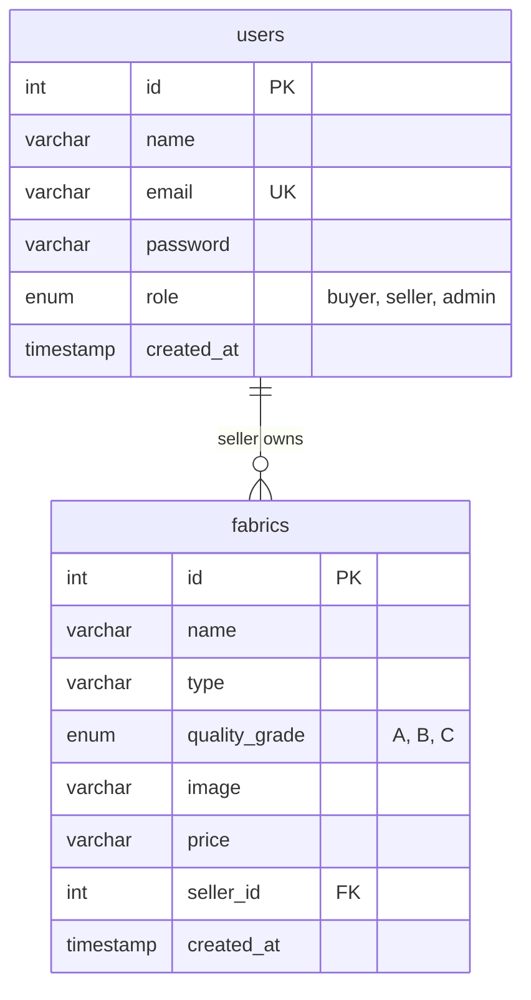

# 🧵 Fabric Marketplace with AI-Based Fabric Defect Detection

<p align="center">
  
  
  
  
  
  
</p>

<p align="center">
  <b>An end-to-end web platform bridging textile e-commerce with automated Computer Vision and Deep Learning quality inspection.</b>
</p>

<p align="center">
  🌐 <b>Live Web Application:</b> <a href="https://clothdefectdetection.vercel.app/" target="_blank"><b>https://clothdefectdetection.vercel.app/</b></a>
</p>

---

## 📑 Table of Contents

- [Overview](#-overview)
- [Key Features](#-key-features)
- [Live Demo](#-live-demo)
- [System Architecture](#-system-architecture)
- [AI & Computer Vision Pipeline](#-ai--computer-vision-pipeline)
  - [Image Defect Detection & Quality Grading](#1-image-defect-detection--quality-grading)
  - [Video Defect Detection](#2-video-defect-detection)
  - [CNN Model Architecture](#3-cnn-model-architecture)
- [User Roles & Dashboard Features](#-user-roles--dashboard-features)
- [Technology Stack](#-technology-stack)
- [Project Directory Structure](#-project-directory-structure)
- [Installation & Local Setup](#-installation--local-setup)
  - [Prerequisites](#prerequisites)
  - [Step-by-Step Guide](#step-by-step-guide)
  - [Git LFS Notice for Model Weights](#git-lfs-notice-for-model-weights)
- [Default Login Credentials](#-default-login-credentials)
- [Database Schema & Architecture](#-database-schema--architecture)
- [Deployment on Vercel](#-deployment-on-vercel)
- [Roadmap & Future Enhancements](#-roadmap--future-enhancements)
- [Author & Acknowledgements](#-author--acknowledgements)

---

## 🌟 Overview

The **Fabric Marketplace with AI-Based Fabric Defect Detection** is a full-stack Flask application designed to solve quality assurance challenges in the textile and garment industry. By integrating automated visual defect inspection directly into a digital fabric marketplace, the system enables:

1. **Suppliers & Sellers** to catalog fabrics, set pricing, and manage their listings.
2. **Buyers & Garment Manufacturers** to browse inventory with real-time AI quality predictions, or upload custom fabric images and videos to inspect for defects before procurement.
3. **Quality Assurance Teams** to eliminate manual, error-prone visual inspection through high-throughput Convolutional Neural Networks (CNN) and OpenCV contour analysis.

---

## 🚀 Key Features

- 🌐 **Live Serverless Deployment:** Accessible online via Vercel at [clothdefectdetection.vercel.app](https://clothdefectdetection.vercel.app/).
- 🛍️ **Multi-Role Marketplace:** Dedicated interfaces for **Buyers**, **Sellers**, and **Administrators**.
- 📸 **AI Image Defect Analysis:** Upload fabric photographs to instantly detect structural flaws with confidence scores.
- 🏷️ **Automated Quality Grading:** Acceptable fabrics are automatically categorized into quality tiers (**Grade A**, **Grade B**, or **Grade C**).
- 🎥 **Video-Based Batch Inspection:** Temporal frame sampling (`frame_interval=10`) scans entire fabric rolls from video clips.
- 🔍 **Contour & Edge Analysis:** Computer vision edge density and contour tracking highlight surface anomalies.
- 🗄️ **Resilient Dual-Database Architecture:** Connects to MySQL with automatic fallback to pre-seeded SQLite for zero-downtime demonstration.
- ⚡ **Lightweight & Fast:** Responsive UI powered by clean semantic HTML5 and tailored CSS.

---

## 🔗 Live Demo

Experience the live application deployed on Vercel:

👉 **[https://clothdefectdetection.vercel.app/](https://clothdefectdetection.vercel.app/)**

> **Note on Cloud Execution:** On serverless cloud infrastructure, the app utilizes lightweight computer-vision heuristic analysis and auto-migrating SQLite storage, providing instant responses without heavy GPU requirements.

---

## 🏗️ System Architecture

```text
                                  +-----------------------+
                                  |      Web Browser      |
                                  | (Buyer, Seller, Admin)|
                                  +-----------+-----------+
                                              |
                                     HTTP GET / POST
                                              |
                                              v
                                  +-----------------------+
                                  |     Flask Backend     |
                                  |       (app.py)        |
                                  +-----+-----------+-----+
                                        |           |
               +------------------------+           +-----------------------+
               |                                                            |
               v                                                            v
    +-----------------------+                                  +-----------------------+
    |  Data Storage Layer   |                                  |   AI & CV Engine      |
    +-----------------------+                                  +-----------------------+
    | * Primary: MySQL      |                                  | * Image CNN:          |
    | * Fallback: SQLite    |                                  |   fabric_defect_model |
    | * Tables:             |                                  | * Video CNN:          |
    |   users, fabrics      |                                  |   video_fabric_model  |
    +-----------------------+                                  | * OpenCV Heuristics:  |
                                                               |   Canny, Contours     |
                                                               +-----------------------+
```

---

## 🧠 AI & Computer Vision Pipeline

### 1. Image Defect Detection & Quality Grading

The single-image prediction pipeline processes fabric samples through the following sequence:

```text
User Upload (Image)
       │
       ▼
OpenCV Decodes Image (cv2.imread)
       │
       ▼
Resize Image (128 × 128 × 3) & Normalize (Pixel / 255.0)
       │
       ▼
CNN Model Inference (Softmax Output)
       │
       ├─► Output Class: "Good Cloth"  ──► Calculate Quality Grade based on Confidence:
       │                                     • Confidence >= 80%  ──► Grade A
       │                                     • 50% <= Conf < 80%  ──► Grade B
       │                                     • Confidence < 50%   ──► Grade C
       │
       └─► Output Class: "Defect Cloth" ──► Suppress Grade (Flagged Flawed)
```

### 2. Video Defect Detection

The video processing pipeline inspects longer stretches of textiles using temporal downsampling:

1. **Video Ingestion:** Accepts uploaded `.mp4` recordings.
2. **Frame Sampling:** OpenCV's `VideoCapture` captures frames at `frame_interval = 10` (sampling 1 frame every 10 frames).
3. **Sequential Classification:** Each sampled frame is preprocessed and evaluated against the binary classification model (Sigmoid $\le 0.5 \implies$ Defect).
4. **Defect Marking:** Frames flagged with defects are passed to `detect_defects()` where Canny edge detection and minimum enclosing circles (`cv2.minEnclosingCircle`) isolate the anomalous regions.
5. **Roll Decision:** If **any** sampled frame exhibits a flaw, the entire clip is labeled **`Defect Cloth ❌`**; otherwise, it passes as **`Non-Defect Cloth ✅`**.
6. **Automated Cleanup:** Temporary extracted frame files are cleanly purged from storage post-inference.

### 3. CNN Model Architecture

Both models are trained using TensorFlow/Keras on representative fabric datasets included in this repository:

#### **Image Classification CNN (`fabric_defect_model.h5`)**
* **Input Dimensions:** $128 \times 128 \times 3$
* **Dataset:** 1,745 fabric images (`Fabric_Dataset/`)
* **Layer Composition:**
  - `Conv2D(32, (3,3), relu)` $\rightarrow$ `BatchNormalization` $\rightarrow$ `MaxPooling2D(2,2)`
  - `Conv2D(64, (3,3), relu)` $\rightarrow$ `BatchNormalization` $\rightarrow$ `MaxPooling2D(2,2)`
  - `Conv2D(128, (3,3), relu)` $\rightarrow$ `BatchNormalization` $\rightarrow$ `MaxPooling2D(2,2)`
  - `Flatten` $\rightarrow$ `Dense(512, relu)` $\rightarrow$ `Dropout(0.5)`
  - `Dense(2, activation='softmax')`
* **Loss Function:** `sparse_categorical_crossentropy` | **Optimizer:** `Adam` | **Epochs:** 15

#### **Video Frame Classification CNN (`video_fabric_defect_model.h5`)**
* **Input Dimensions:** $128 \times 128 \times 3$
* **Dataset:** 462 frame images extracted from roll videos (`Dataset/`)
* **Layer Composition:**
  - `Conv2D(32, (3,3), relu)` $\rightarrow$ `MaxPooling2D(2,2)`
  - `Conv2D(64, (3,3), relu)` $\rightarrow$ `MaxPooling2D(2,2)`
  - `Flatten` $\rightarrow$ `Dense(128, relu)` $\rightarrow$ `Dropout(0.5)`
  - `Dense(1, activation='sigmoid')`
* **Loss Function:** `binary_crossentropy` | **Optimizer:** `Adam(lr=0.0001)` | **Epochs:** 10

---

## 👥 User Roles & Dashboard Features

| Feature / Action | 🛍️ Buyer | 🏭 Seller | 🛡️ Admin |
| :--- | :---: | :---: | :---: |
| Self-Registration via UI | ✅ | ✅ | ❌ |
| Browse Listed Fabrics | ✅ | ❌ | ❌ |
| Dynamic AI Inspection on Marketplace Cards | ✅ | ❌ | ❌ |
| Contact Sellers (`mailto:` integration) | ✅ | ❌ | ❌ |
| Upload Single Image for AI Quality Inspection | ✅ | ❌ | ❌ |
| Upload Video for Temporal Roll Inspection | ✅ | ❌ | ❌ |
| Add New Fabric Product with Images | ❌ | ✅ | ❌ |
| Delete Owned Fabric Listings | ❌ | ✅ | ❌ |
| View System Users Table | ❌ | ❌ | ✅ |

---

## 💻 Technology Stack

- **Backend Framework:** [Flask 3.0.3](https://flask.palletsprojects.com/) / Python 3.10
- **Deep Learning:** [TensorFlow 2.8+](https://www.tensorflow.org/) & [Keras](https://keras.io/)
- **Computer Vision:** [OpenCV (cv2)](https://opencv.org/) (`opencv-python` / `opencv-python-headless`)
- **Scientific Computing:** [NumPy](https://numpy.org/) & [scikit-learn](https://scikit-learn.org/)
- **Primary Database:** [MySQL](https://www.mysql.com/) (`mysql-connector-python`)
- **Fallback Database:** SQLite (`sqlite3`) with custom compatibility adapter
- **Frontend:** Semantic HTML5, Custom Responsive CSS3, Jinja2 Templating
- **Cloud Hosting:** [Vercel Serverless Functions](https://vercel.com/)

---

## 📁 Project Directory Structure

```text
Cloth-Defect-Detection/
├── .gitattributes                     # Git LFS tracking rules for .h5 and .mp4 binaries
├── .gitignore                         # Build and runtime artifact ignore rules
├── .vercelignore                      # Deployment filter for serverless bundle
├── App.bat                            # Windows double-click application launcher
├── app.py                             # Core Flask backend application
├── fabric_defect_model.h5             # Trained single-image CNN model weights
├── video_fabric_defect_model.h5       # Trained video-frame binary CNN model weights
├── fabric_marketplace-DB.sql          # MySQL database schema and seed data
├── Fabric_requirements.bat            # Dependency setup script for Windows
├── README.md                          # Comprehensive project documentation
├── requirements.txt                   # Production pip dependencies
├── train_model.py                     # Training routine for single-image model
├── video_train_model.py               # Training routine for video frame model
├── vercel.json                        # Vercel serverless routing definition
│
├── Dataset/                           # Video training dataset
│   ├── Defect/                        # Extracted defective frames (195 images)
│   └── Non_Defect/                    # Extracted clean frames (267 images)
│
├── Fabric_Dataset/                    # Main CNN image training dataset
│   ├── Defect Cloth/                  # Flawed fabric images (839 images)
│   └── Good Cloth/                    # Intact fabric images (906 images)
│
├── Test/                              # Sample evaluation images (453 images)
├── Videos/                            # Sample test video clips
├── static/
│   ├── images/                        # UI assets (e.g., bg.jpg)
│   └── uploads/                       # User upload directory
└── templates/                         # Jinja2 presentation templates
    ├── admin_dashboard.html           # Administrator dashboard
    ├── buyer_dashboard.html           # Buyer marketplace and inspection dashboard
    ├── index.html                     # Public landing page
    ├── login.html                     # User authentication form
    ├── register.html                  # User account creation form
    └── seller_dashboard.html          # Seller inventory management dashboard
```

---

## ⚙️ Installation & Local Setup

### Prerequisites

- **Python 3.8 to 3.10** installed on your system.
- **Git** with [Git LFS](https://git-lfs.github.com/) installed (to pull `.h5` model files).
- *(Optional)* **MySQL Server** installed (e.g., MySQL Workbench or XAMPP). If omitted, the app automatically switches to SQLite.

---

### Step-by-Step Guide

#### 1. Clone the Repository

```bash
git clone https://github.com/jayachandra2003/Cloth-Defect-Detection.git
cd Cloth-Defect-Detection
```

#### 2. Pull Git LFS Model Binaries

> ⚠️ **Important:** The trained deep learning models (`.h5`) and sample `.mp4` videos are managed with Git Large File Storage (Git LFS). Run:

```bash
git lfs install
git lfs pull
```

#### 3. Create and Activate a Virtual Environment

* **On Windows:**
  ```powershell
  python -m venv venv
  venv\Scripts\activate
  ```
* **On macOS / Linux:**
  ```bash
  python3 -m venv venv
  source venv/bin/activate
  ```

#### 4. Install Dependencies

For standard execution with Computer Vision and MySQL:
```bash
pip install -r requirements.txt
```

To include full TensorFlow training capabilities locally:
```bash
pip install tensorflow opencv-python scikit-learn
```

#### 5. Database Setup (Optional MySQL)

1. Open MySQL Workbench or your database management tool.
2. Create the database and import the tables:
   ```sql
   CREATE DATABASE fabric_marketplace;
   USE fabric_marketplace;
   SOURCE fabric_marketplace-DB.sql;
   ```
3. Set your environment variables (or edit `db_config` in `app.py`):
   ```bash
   export DB_HOST="localhost"
   export DB_USER="root"
   export DB_PASSWORD="YOUR_PASSWORD"
   export DB_NAME="fabric_marketplace"
   ```

*(If you skip this step, the app automatically boots up using local pre-seeded SQLite with no manual configuration required!)*

#### 6. Start the Application

* **Option A (Terminal):**
  ```bash
  python app.py
  ```
* **Option B (Windows Quick Launch):**
  Double-click `App.bat`.

Open your web browser and navigate to:
```text
http://127.0.0.1:5000
```

---

## 🔑 Default Login Credentials

The application is pre-seeded with accounts for all roles:

| Role | Email Address | Password | Purpose |
| :--- | :--- | :--- | :--- |
| **Administrator** | `admin@gmail.com` | `admin` | User monitoring dashboard |
| **Buyer** | `aravind@gmail.com` | `aravind` | Marketplace inspection & purchase |
| **Seller** | `venkat@gmail.com` | `venkat` | Inventory listing & management |
| **Buyer** | `ramu@gmail.com` | `ramu` | Secondary buyer account |

---

## 🗄️ Database Schema & Architecture

The database model connects buyers, sellers, and fabrics through relational foreign keys:



---

## ☁️ Deployment on Vercel

The application includes native configuration for serverless deployment on Vercel:

1. **Routing Definition:** [`vercel.json`](file:///d:/projects/Cloth-Defect-Detection-main/vercel.json) routes incoming requests to `@vercel/python` running `app.py`.
2. **Ephemeral Storage Adaptation:** On serverless runs (`IS_VERCEL = True`), upload directories and databases migrate seamlessly to `/tmp`.
3. **Bundle Optimization:** Large training datasets and scripts are excluded via [`.vercelignore`](file:///d:/projects/Cloth-Defect-Detection-main/.vercelignore) to stay within serverless function deployment limits.

Live deployment: [https://clothdefectdetection.vercel.app/](https://clothdefectdetection.vercel.app/)

---

## 🔮 Roadmap & Future Enhancements

- [ ] **Multi-Class Defect Categorization:** Extend the CNN to classify specific textile flaws (e.g., *Slub*, *Hole*, *Weft Tear*, *Stain*, *Color Bleed*).
- [ ] **Object Detection Integration:** Implement YOLOv8 / Faster R-CNN for real-time bounding box localization on defect coordinates.
- [ ] **Integrated Payment Gateway:** In-app escrow checkout and order tracking for end-to-end e-commerce.
- [ ] **Real-Time Camera Stream:** Direct WebRTC/RTSP camera feed support for manufacturing line conveyor inspection.
- [ ] **Security Hardening:** Password hashing using `bcrypt` and CSRF protection on form submissions.

---

## 👨‍💻 Author & Acknowledgements

* **Developer:** Jaya Chandra Vennam
* **GitHub:** [@jayachandra2003](https://github.com/jayachandra2003)
* **Repository:** [Cloth-Defect-Detection](https://github.com/jayachandra2003/Cloth-Defect-Detection)
* **Live Deployment:** [clothdefectdetection.vercel.app](https://clothdefectdetection.vercel.app/)

---

<p align="center">
  ⭐ <i>If you found this project helpful, please give it a star on GitHub!</i> ⭐
</p>
